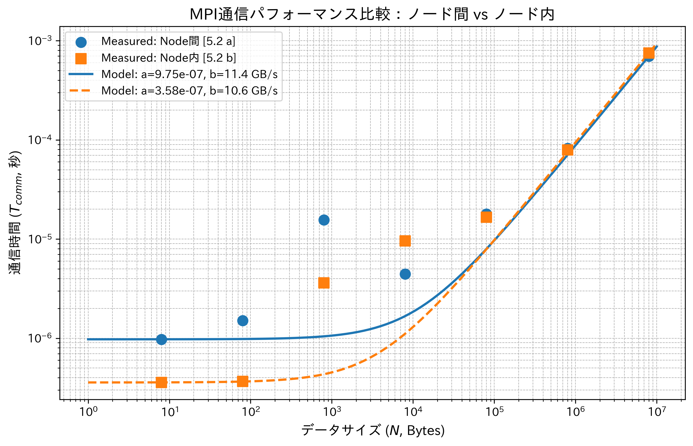

# 高性能並行プログラミング (主専攻実験K-9) 進捗ログ

## 4.3 

[課題] アムダールの法則に従い，式 (4) を元に，プロセッサ数 p が無限大になった極限において，S(p)，及び E(p) がどうなるかを考察せよ．

$S(p) = \frac{T_1}{T(p)}$, 
$E(p) = \frac{S(p)}{p}$, 
$T(p) = T_s + \frac{T_p}{p}$, 
$( T_1 = T_s + T_p )$
より、

$$
\begin{aligned}
\lim_{p \to \infty} S(p) = \lim_{p \to \infty} \frac{T_s+T_p}{T_s + \frac{T_p}{p}} = \frac{T_s + T_p}{T_s} = 1 + \frac{T_p}{T_s} \\
\lim_{p \to \infty} E(p) = \lim_{p \to \infty} \frac{1}{p}\cdot\frac{T_s + T_p}{T_s + \frac{T_p}{p}} = \lim_{p \to \infty} \frac{T_s + T_p}{pT_s + T_p} = 0
\end{aligned}
$$

よって、$S(p)$は$1+\frac{T_p}{T_s}$に収束し、$E(p)$は$0$に収束する。

## 4.4

[課題] スーパーコンピュータ Pegasus における，ノード間 MPI 通信の性能を調べ，式 (5) の a，及び b に相当するパラメータを求めよ．同様に，ノード内のプロセッサ間で MPI 通信を行った場合についても調べよ

$T_{comm} = a + \frac{N}{b}$ ... (5)

方針: 簡易的な方法として、2点を通る直線による算出を行う。

方法: [5.2]で行なった通信実験の結果をもとに、計算する。データサイズは、8 Bytes($N_1=8$)と8,000,000 Bytes($N_2=8,000,000$)の2点を用いる。

（有効数字は3桁程度で表記する）

### ノード間(5.2 a)の計算

- a（固定コスト）

データ量が極めて小さい時($N_1=8$)の時間をaの値として近似する。

$$
a \approx 9.74 \times 10^{-7} \text{ sec}
$$

- b(単位時間あたりに転送できる通信量単位)

$T_{comm} = a + \frac{N}{b}$より、$b = \frac{N}{T_{comm} - a}$で算出できるが、今回の場合、データ量0の時の固定コストではなく、$N_1=8$ Bytesの時の時間をaの値として近似しているため、実質的な２点間の傾き$\frac{\delta T}{\delta N}$の逆数をbの値として近似する。

$$
\begin{aligned}
   b \approx \frac{N_2 - N_1}{T_{2} - T_{1}} = \frac{8,000,000\ Bytes - 8\ Bytes}{0.000698334\ sec - 9.74 \times 10^{-7}\ sec} \\
   b \approx 1.147 \times 10^9 \text{ Bytes/sec} \approx 11.4\ GB/s
\end{aligned}
$$

### ノード内(5.2 b)の計算

- a（固定コスト）
$$
a \approx 3.58 \times 10^{-7} \text{ sec}
$$

- b(単位時間あたりに転送できる通信量単位)
$$
\begin{aligned}
   b \approx \frac{8000000\ Bytes - 8\ Bytes}{0.000753341\ sec - 3.58 \times 10^{-7}\ sec} \\
   b \approx 1.062 \times 10^9 \text{ Bytes/sec} \approx 10.6\ GB/s
\end{aligned}
$$

### まとめ

| 環境 | レイテンシ $a$ (sec) | バンド幅 $b$ (GB/s) |
| --- | --- | --- |
| ノード間 (5.2 a) | $9.74 \times 10^{-7}$ | 11.4 |
| ノード内 (5.2 b) | $3.58 \times 10^{-7}$ | 10.6 |

両端の２点を結んだ直線を描画すると、以下のようになる。

（両軸対数グラフのため、直線ではないが、傾きは同じである）




## 5.1 OpenMPによる並列化実験

(a) 配列データの総和(整数、浮動小数点数)
(b) 関数を作用させた配列の総和(ex. 1/m sin(1/m) (m=1,2,...,N)の総和)
(c) m行k列の行列Aとk行n列の行列Bの積C=AB(m行n列)の計算

<!-- 
仮説
- (a): メモリバウンドによって、スレッド数を増やしても性能が頭打ちになる可能性がある。
- (b): (a)と同様に、メモリバウンドの影響が大きいと予想されるが、関数の計算コストがあるため、(a)よりはスレッド数の増加による性能向上が見られる可能性がある。
- (c): データサイズが小さいときは、計算が一瞬で終わるため、並列化のオーバーヘッドが勝り、スレッドを増やすと逆に遅くなる可能性。行列が十分に大きい場合、スレッド数に応じて十分に早くなる。

 -->

### コードの説明

#### 配列サイズNを変化させて、性能評価を行うコード。

- `openmp_tasks.cpp`: (a),(b),(c)の時間を計測するコード。スレッド数は１で固定し、配列のサイズ(N)を変化させて計測する。
   - (a), (b): $N = [10, 1000, 10^6, 10^7, 10^8]$
   - (c): $m=k=n=[10, 100, 500, 1000]$
- `openmp_tasks.sh`: `openmp_tasks.cpp`を実行するシェルスクリプト。
   - スレッド数は1。

#### 配列サイズを固定して、スレッド数を変化させる場合の性能評価を行うコード。

- `openmp_tasks_constN.cpp`: `openmp_tasks.cpp`の配列サイズを固定したもの。
   - (a): $N = 10^6$
   - (b): $N = 10^6$
   - (c): $m=k=n=100$
- `openmp_tasks_constN.sh`: `openmp_tasks_constN.cpp`を実行するシェルスクリプト。
   - スレッド数は、[1, 2, 4, 8, 16, 32, 64, 128, 256]で変化させる。

### 実行環境

**ppx2-00**

### 実行方法

`.cpp`をコンパイル後、`.sh`を用いて実行。

(`openmp_tasks_constN.cpp`と`openmp_tasks_constN.sh`の例)

```bash
$ g++ -fopenmp -O2 openmp_tasks_constN.cpp -o openmp_tasks_constN
$ sbatch ./openmp_tasks_constN.sh
```

<!-- Nを固定してスレッド数を増やす実験と、スレッド数を固定してデータサイズを増やす実験を行う -->

### 実行結果

#### Nを変化させた例

```csv
num_of_threads = 1
A_Int, 1, 10, 1.022e-05
A_Int, 1, 1000, 3.44e-06
A_Int, 1, 1000000, 0.000178158
A_Int, 1, 10000000, 0.00322836
A_Int, 1, 100000000, 0.0239458
A_Float, 1, 10, 3.25001e-06
A_Float, 1, 1000, 2.05e-06
A_Float, 1, 1000000, 0.000902961
A_Float, 1, 10000000, 0.00950642
A_Float, 1, 100000000, 0.103777
B, 1, 10, 1.999e-05
B, 1, 1000, 8.79999e-06
B, 1, 1000000, 0.00839176
B, 1, 10000000, 0.0836077
B, 1, 100000000, 0.821955
C, 1, 10x10, 1.69e-06
C, 1, 100x100, 0.000694853
C, 1, 500x500, 0.117294
C, 1, 1000x1000, 0.92576
```

#### スレッド数を変化させた例

(最初のみ抜粋)

```csv
Task,Threads,N,Time(sec)
A_Int, 1, 1000000, 0.000290827
A_Float, 1, 1000000, 0.00132624
B, 1, 1000000, 0.00916219
C, 1, 100x100, 0.00119395
A_Int, 2, 1000000, 0.000411857
```

#### N=10^6(Cは100x100)の時のスレッド数を変化させた時のグラフと表


```csv
```

### 5.1の考察

<!-- - N=100万の時は計算が軽すぎるため、1→2スレッドで逆に遅くなる（オーバヘッドの壁）現象が観測された。一方、N=1億の時はオーバヘッドが隠蔽され、理想的なスケーリング（台数効果）が確認できた。 -->


## 5.2 MPIによる通信実験

### 5.2 (a) ノード間（別PC）の通信性能テスト
<!-- * **目的**: 物理的に異なる2つの計算ノード間でPing-Pongテストを行い、ノード内通信（Macローカル）と比較した際のレイテンシとバンド幅の悪化を観測する。 -->
* **実行環境**: PPX (研究室クラスタ), Slurmジョブスクリプト (`-N 2 -n 2`)

**実行結果:**

| データサイズ (Bytes) | 片道時間 (sec) |
| --- | --- |
| 8 | 9.74980e-07 |
| 80 | 1.51068e-06 |
| 800 | 1.56235e-05 |
| 8000 | 4.44288e-06 |
| 80000 | 1.79538e-05 |
| 800000 | 8.21658e-05 |
| 8000000 | 0.000698334 |


### 5.2 (a) の考察（ノード間 vs ノード内）


### 5.2 (b) ノード内（同一CPU上）プロセス間通信テスト
<!-- * **目的**: 同一ノード内におけるPing-Pongテストを通じ、通信のレイテンシ $a$ とバンド幅 $b$ を測定し、(a)のノード間通信と純粋な比較を行う。 -->
* **実行環境**: PPX (研究室クラスタ), Slurmジョブスクリプト (`-N 1 -n 2`)

**実行結果:**

| データサイズ (Bytes) | 片道時間 (sec) |
| --- | --- |
| 8 | 3.57885e-07 |
| 80 | 3.66985e-07 |
| 800 | 3.60743e-06 |
| 8000 | 9.55833e-06 |
| 80000 | 1.66147e-05 |
| 800000 | 7.94011e-05 |
| 8000000 | 0.000753341 |

### 5.2 (a)(b) の考察（ノード間 vs ノード内）


### 5.2 (d) Collective（集団）通信の性能テスト
<!-- * **目的**: 1対多の通信（Broadcast）や、多対多の通信（Allgather）において、手動でPoint-to-Point通信（`MPI_Send`/`Recv`）を繰り返した場合と、MPIのCollective関数（`MPI_Bcast`等）を用いた場合の性能を比較する。 -->
* **実行環境**: PPX (研究室クラスタ), 4プロセスで実行
  * **2ノード構成**: `-N 2 -n 4` (1ノードあたり2プロセスが同居)
  * **4ノード構成**: `-N 4 -n 4` (1ノードあたり1プロセスが専有)

**実行結果 (2ノード構成 / 1ノード2プロセス):**

| Data_Bytes |　手動Bcast(s) | MPI_Bcast(s) | MPI_Allgather(s) |
| --- | --- | --- | --- |
| 8 | 0.000001 | 0.000002 | 0.000002 |
| 80 | 0.000000 | 0.000000 | 0.000004 |
| 800 | 0.000035 | 0.000005 | 0.000034 |
| 8000 | 0.000009 | 0.000012 | 0.000017 |
| 80000 | 0.000031 | 0.000019 | 0.000067 |
| 800000 | 0.000215 | 0.000105 | 0.000381 |
| 8000000 | 0.001882 | 0.001502 | 0.005983 |

**実行結果 (4ノード構成 / 1ノード1プロセス):**

| Data_Bytes | 手動Bcast(s) | MPI_Bcast(s) | MPI_Allgather(s) |
| --- | --- | --- | --- |
| 8 | 0.000000 | 0.000000 | 0.000002 |
| 80 | 0.000000 | 0.000000 | 0.000003 |
| 800 | 0.000000 | 0.000003 | 0.000005 |
| 8000 | 0.000001 | 0.000012 | 0.000011 |
| 80000 | 0.000037 | 0.000033 | 0.000053 |
| 800000 | 0.000239 | 0.000207 | 0.000302 |
| 8000000 | 0.002078 | 0.001635 | 0.002860 |

### 5.2 (d) の考察


### 5.2 (e) 通信の競合（ネットワーク輻輳）テスト
* **実行環境**: PPX (研究室クラスタ), 2ノードに8プロセスを配置 (`-N 2 -n 8`)

**実行結果:**

| Data_Bytes | Single_Pair(s) | Multiple_Pairs(s) |
| --- | --- | --- |
| 8 | 0.000001 | 0.000001 |
| 80 | 0.000001 | 0.000001 |
| 800 | 0.000003 | 0.000003 |
| 8000 | 0.000007 | 0.000009 |
| 80000 | 0.000011 | 0.000017 |
| 800000 | 0.000115 | 0.000119 |
| 8000000 | 0.001110 | 0.002026 |


### 5.2 (e) の考察

## 寄り道: Rust(Rayon)による並列化実験

Rustにも、C++のOpenMPやMPIのような並列処理を簡単に実装できるライブラリが存在することを知ったので、実験してみた。

<!-- ### 5.1(a) Rust(Rayon)版 -->

<!-- ```rust:src/main.rs
use rayon::prelude::*;
use std::time::Instant;

fn main() {
    let n = 100_000_000;
    
    // 1.0 で埋められた1億個の要素を持つ配列（ベクタ）を作成
    // ※これは計測時間外（準備）です
    let a: Vec<f64> = vec![1.0; n];

    // 計測開始
    let start = Instant::now();

    // 並列処理による総和計算
    // 通常のイテレータ `iter()` を `par_iter()` に変えるだけ！
    let s: f64 = a.par_iter().sum();

    // 計測終了
    let duration = start.elapsed();

    // 結果出力
    println!("=== OpenMP vs Rayon (Rust) ===");
    println!("[Task A] Sum: {:.6}, Time: {:.6} sec", s, duration.as_secs_f64());
}
``` -->

### 5.1(a) Rust(Rayon)版: 実行結果
<!-- 
hpcuser@d0729cdd7725:/workspaces/parallel-programming-exp/task_a_rust$ cargo run --release
    Finished `release` profile [optimized] target(s) in 0.03s
     Running `target/release/task_a_rust`
=== OpenMP vs Rayon (Rust) ===
[Task A] Sum: 100000000.000000, Time: 0.010524 sec
hpcuser@d0729cdd7725:/workspaces/parallel-programming-exp/task_a_rust$ cargo run --release
    Finished `release` profile [optimized] target(s) in 0.02s
     Running `target/release/task_a_rust`
=== OpenMP vs Rayon (Rust) ===
[Task A] Sum: 100000000.000000, Time: 0.009364 sec
hpcuser@d0729cdd7725:/workspaces/parallel-programming-exp/task_a_rust$ cargo run --release
    Finished `release` profile [optimized] target(s) in 0.02s
     Running `target/release/task_a_rust`
=== OpenMP vs Rayon (Rust) ===
[Task A] Sum: 100000000.000000, Time: 0.008200 sec
 -->

| 実行回数 | Rust(Rayon) Task A 時間 (秒) |
| --- | --- |
| 1 | 0.010524 |
| 2 | 0.009364 |
| 3 | 0.008200 |

<!-- 1. **Rust(Rayon)の驚異的な性能**: Rustの並列処理ライブラリであるRayonを用いてTask Aを実装したところ、MacローカルのC++版（約0.0094秒）と同等の性能（約0.0082秒）。 -->

### Work-strealingの体感用

- 三角関数ループの実装。

- C++版: `#pragma omp parallel for` を用いてループを並列化。
   - `/workspaces/parallel-programming-exp/unbalanced.cpp`
- C++(schedule(dynamic))版: `#pragma omp parallel for schedule(dynamic)` を用いてループを並列化。
   - `/workspaces/parallel-programming-exp/unbalanced.cpp` （編集済み）
- Rust(Rayon)版: `par_iter()` を用いてループを並列化。
   - `/workspaces/parallel-programming-exp/unbalanced_rust/src/main.rs`

#### 実行結果


| 実行回数 | C++ (OpenMP) 時間 (秒) | C++ (OpenMP + schedule(dynamic)) 時間 (秒) | Rust(Rayon) 時間 (秒) |
| --- | --- | --- | --- |
| 1 | 0.785564 | 0.586284 | 0.591402 |
| 2 | 0.798154 | 0.601501 | 0.576145 |
| 3 | 0.619695 | 0.586284 | 0.590889 |

## 5.4 重力プログラミング(N体問題)

* **実行環境**: PPX, 2ノードに8プロセスを配置 (`-N 2 -n 8`)
* **条件**: 
  * OpenMP: Static / Dynamic スケジューリング
  * MPI: 4プロセス並列 (`-np 4`)
* **試行回数**: 各 $N$ に対して 3回実行した平均値

### 計測結果 (単位: 秒)

| Particles ($N$) | OpenMP (Static) | OpenMP (Dynamic) | MPI (4-proc) |
| --- | --- | --- | --- |
| **1000** | 0.012989 | 0.005777 | 0.004749 |
| **5000** | 0.084548 | 0.071633 | 0.125297 |
| **10000** | 0.325343 | 0.284311 | 0.504013 |
| **20000** | 1.218463 | 1.241327 | 1.990713 |

<!-- ### 考察とインサイト
1. **アルゴリズム計算量の実証**: 
   $N=10000$ から $N=20000$ にかけて、星の数が2倍になると計算時間は約3.7〜3.9倍に増加している。これはN体問題の理論的な計算量 $O(N^2)$ （データ量が2倍になれば計算量は4倍になる）に極めて忠実に従っていることを示している。
2. **共有メモリ (OpenMP) の挙動**: 
   StaticとDynamicで大きな性能差は見られない。これは、各星の重力計算にかかる負荷が均質であるため、動的なタスク割り当ての恩恵が薄いためであると推測される。
3. **通信オーバーヘッドの壁 (MPI)**: 
   今回のPPX上の計測結果では、$N \ge 5000$ において、MPI（4プロセス）がOpenMPよりも遅い結果となった。これは、ステップ毎に全プロセスの位置情報を共有するための集合通信（`MPI_Allgather`）のオーバーヘッドが、計算の並列化による恩恵を上回ってしまったためと考えられる。分散メモリ環境においては、通信と計算の粒度（Granularity）のバランス設計が極めて重要であることがデータから実証された。 -->
